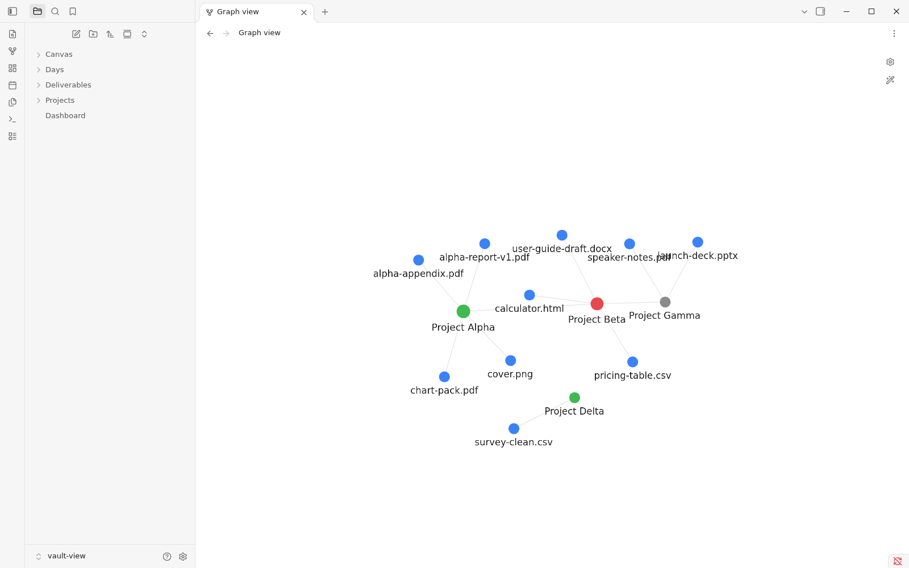
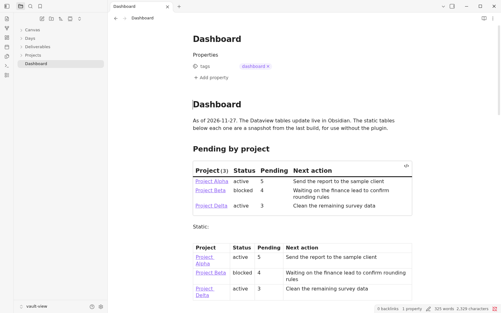

# log-to-obsidian

Turns plain-text `PROGRESS-LOG.md` files into an Obsidian vault. Every project, deliverable and work day becomes a linked note, so Graph view shows how it all connects, and a Dashboard note shows what is pending, delivered, stale and blocked.

- One command: `node build-vault.js --config config.json`
- Node 18 or newer. No dependencies. **No network calls, no telemetry.**
- Reads your logs, index and project folders. **Never edits or deletes them.** Writes only inside `vault/`.
- Same input and same date give byte-identical output (see "Dates and repeatable output"), so it is safe to run on a schedule. Unchanged files are not rewritten.
- Everything in this ZIP is made-up sample data ("Project Alpha" and friends). Your real data stays on your machine.




The screenshots were taken in Obsidian 1.15.1 with Dataview 0.5.70 open on `sample-vault/`. More in `screenshots/`.

## Setup in 5 steps

1. **Install Obsidian** from https://obsidian.md and Node 18+ from https://nodejs.org.
2. **Install Dataview**: in Obsidian open Settings > Community plugins > Turn on community plugins > Browse > "Dataview" > Install > Enable. (Without it the Dashboard still works: each table has a static copy underneath.)
3. **Edit the config**: copy `config.example.json` to `config.json` and set `scan` (folders or `*` patterns, any drive), `indexFile` (your root index markdown) and optionally `vaultDir`.
4. **Run it**: `node build-vault.js --config config.json`
5. **Open the vault**: in Obsidian choose "Open folder as vault" and pick the `vault/` folder. Open `Dashboard`, then the Graph view.

Try it first on the samples: `node build-vault.js --config sample-input/config.json` (writes `sample-vault/`).

## Config (`config.json`)

| key | meaning |
| --- | --- |
| `scan` | list of folders or patterns, e.g. `"C:/Users/you/Downloads/*"`, `"D:/*"`. `*` and `?` work in any path segment. A folder counts as a project only if it contains `PROGRESS-LOG.md`. |
| `indexFile` | markdown file with a `\| Project \| Stage \| Last touched \| Next action \|` table (column order may vary). |
| `vaultDir` | output folder, default `./vault`, relative to the config file. |
| `staleDays` / `recentDays` | 14 and 7 by default. |
| `asOf` | fixed date `YYYY-MM-DD` for the static dashboard tables. Leave `null` to use today. (`--as-of` does the same from the command line.) |
| `projectTags` | extra tags per project, e.g. `{"Some Project": ["private"]}`. |

## Auto-update

- **Watch mode**: `node build-vault.js --config config.json --watch` rebuilds whenever a `PROGRESS-LOG.md` or the index changes (checks every 2 seconds; no file-system event quirks on network drives).
- **Every 30 minutes on Windows**: put the folder somewhere permanent, then run `schedule\install-task.cmd`. It registers a task called `ProjectLogVault` that runs `schedule\run-build.cmd` (uses `config.json` in this folder; the scheduler's own log goes to `schedule\build-vault.log`, outside your vault and separate from the builder, which writes nothing but the vault). Remove it with `schtasks /Delete /TN ProjectLogVault /F`. Prefer to import the XML? Edit the two `C:\path\to\log-to-obsidian` entries in `schedule\vault-every-30min.xml` and import it in Task Scheduler.
- **Private projects**: `node build-vault.js --config config.json --private-tags`. Any project tagged `private` in `projectTags` becomes a node with only its name, counts and status: no summary, pending text, next action or deliverable notes, and it is left out of day notes and dashboard text.

## Dates and repeatable output

The dashboard needs to know "today" for its static tables (delivered in the last 7 days, stale after 14). By default that is today's date, so the same input gives identical output within a day, and the static tables correctly change when the day changes. The Dataview tables use Obsidian's own clock and are always current. For fully repeatable output, pin the date: `--as-of 2026-11-27` or `"asOf"` in the config. The shipped `sample-vault/` is pinned to 2026-11-27.

## Output safety

Before writing anything the builder checks, and stops with an error (nothing written) if:

- the vault folder, any folder in its path below the config folder, or anything inside the vault is a symlink or Windows junction;
- the vault is inside, or contains, any project folder, the index file or the config file (compared by real path).

Files are written to a temporary file and renamed into place, so a hard link in the vault can never write through to one of your files. Inputs are only ever read.

## What it writes

```
vault/
  Dashboard.md                 Dataview queries + static fallback tables
  Projects/<Project>.md        frontmatter, summary, Pending, Delivered, Timeline, Related
  Deliverables/<file>.md       type, date, size, [[Project]], file:/// link to the real file
  Days/YYYY-MM-DD.md           one per date found in any log
  Canvas/Overview.canvas       projects in columns by status
  .obsidian/graph.json         colour groups, day nodes hidden
```

Generated notes end with a `%% generated by build-vault.js %%` marker. Each run rewrites those and deletes only marked notes that no longer apply. **Notes you add yourself (any folder) are never touched**, even inside `Projects/`. `.obsidian/graph.json` and the canvas are fully owned by the tool, so keep graph tweaks in your own notes' settings or copy the file.

Graph colours: active green, waiting amber, blocked red, done and parked grey, deliverables blue, days faint grey. Day nodes are hidden by the graph filter `-tag:#day` (also hides Dashboard and the canvas). To show days, clear or edit that filter in the Graph view's filter box (see `screenshots/graph-view-with-days.png`).

## Parsing rules

- Log sections: `## YYYY-MM-DD`, optionally `## YYYY-MM-DD (later)`. Labels: `**Done:**`, `**Decisions:**`, `**Unverified:**`, `**Next:**`, `**Also built:**`, `**Delivered:**` (`**Done**:` also works). An item is the text after the label plus any sub-bullets or continuation lines.
- **Done** = anything under `Done`, `Delivered` or `Also built`.
- **Pending** = every `Next` and `Unverified` item, unless it is ticked `[x]`, or a **later section** has a done item sharing 70% or more of the pending item's words (case-insensitive, light stemming, common filler words ignored). A done item in the same section does not clear it.
- **Status**: `done` if the index Stage says done, wrapped, complete or shipped; `parked` if Stage says parked, paused or on hold; `blocked` if the newest `Next` contains "needs", "waiting on" or "blocked"; otherwise `waiting` if Stage says waiting; otherwise `active`. Stale is computed from `last_touched`, never stored.
- `last_touched` is the newest log date (falls back to the index, then newest file date). Deliverable dates are file modified dates in UTC.
- Deliverables: `.pdf .html .mp4 .csv .docx .pptx .png` anywhere inside the project folder. Skipped: folders `_to-delete`, `node_modules`, `.git`, raw-footage folders (`raw`, `footage`, `rushes`, `b-roll`, `dailies`, `clips`) and camera-style `.mp4` names (`raw-*`, `footage*`, `MVI_*`, `DSC_*`, `GOPR*`).
- Related: project A links to project B when A's log mentions B's folder name or project name.
- Handles CRLF, a leading BOM, emoji, very long table cells (pipes inside code spans, `[[a|b]]` links or `\|` are kept), empty logs and missing sections. Labels inside code fences are ignored.

## Tests

`npm test` (or `node --test test/parser.test.js test/vault.test.js test/watch.test.js`): parser cases on tricky logs, index table parsing, status rules, idempotency (second run byte-identical, unchanged files not rewritten), input files untouched, only `vault/` written, owner notes preserved, private mode, every `[[link]]` resolves, watch mode rebuilds, and a check that the source imports only `fs` and `path`.

## Regenerating the samples

Git does not keep file modified dates, so after cloning run `npm run sample` once to restore the sample files' fixed dates (deliverable dates come from file dates).

`npm run sample` rebuilds `sample-input/` (with fixed file dates) and `sample-vault/`. The `file:///` links in the shipped `sample-vault/` use the placeholder `/path/to/log-to-obsidian`; a fresh run writes links to your real location.

## Limits

- Dataview's own table styling depends on your Obsidian theme.
- The static tables are a snapshot at build time, so they age until the next run. The Dataview tables do not.
- Obsidian itself may contact its servers (for example to check for updates). That is Obsidian, not this tool.
